# PowerShell for IAM Automation

**Four scripts. Ten new hires in under half a second. One Leaver caught holding a key.**

This is Week 8 of my 12 week IAM Engineer portfolio. I wrote four PowerShell scripts that do the identity work people usually click through by hand: a Joiner script that creates accounts in bulk from an HR file, a weekly report that finds accounts nobody is using, an audit that shows who really holds each group's access, and an alarm that goes off when someone uses the break glass account. That last one closes out CA005, the alert I deferred from Week 7.

I fed the scripts messy data on purpose, measured them against doing the same work by hand, scheduled one to run by itself, and then watched that scheduled run fail in a way it never failed when I tested it myself. Tracking that down was the most valuable hour of the week.

Every claim in this write up is backed by a screenshot or an evidence file in this repo.

---

## The 30 second version

| Question | Answer |
|---|---|
| **What problem does this solve?** | Identity work done by hand is slow, easy to get wrong, and hard to prove later. A new hire takes minutes of clicking, inactive accounts pile up unnoticed, disabled users keep their group access, and nobody notices when the emergency admin account gets used. |
| **What did I build?** | Four scripts. `New-BulkADUsers` (Joiner automation from CSV), `Get-InactiveADUsers` (90 day stale account report with manager lookup, scheduled weekly), `Get-ADGroupMembershipAudit` (direct and nested membership with risk flags), and `Watch-BreakGlassSignIn` (Entra ID sign in logs through Microsoft Graph, written to the Windows Event Log). Every script has preflight checks, a timestamped log, a results CSV, and exit codes. |
| **How did I prove it works?** | A timed manual baseline against a timed script run, a WhatIf dress rehearsal before every change, a rerun that proved nothing gets duplicated, a scheduled task that ran unattended and returned 0x0 with a matching log, a planted Leaver that the audit caught and a clean rerun after the fix, and a real break glass sign in that fired the alert. |
| **Tools** | Windows PowerShell 5.1, ActiveDirectory module, Active Directory Users and Computers, Task Scheduler, Event Viewer, Microsoft Graph PowerShell (Authentication and Reports), Microsoft Entra ID P2 (trial), Windows Server 2022 |
| **Built on** | September 29, 2026 |

---

## Explain it like I am in 5th grade

Picture a school office. Every time a new kid joins, someone makes them an ID card, writes their name in five different books, and hands them the right locker keys. That someone gets tired, makes typos, and sometimes forgets a key. Kids who moved away months ago still have keys in their pockets. Nobody counts who holds which key. And there is a fire alarm box with a spare master key, but no alarm on the box.

This week I built four robots for that office. The first one reads the list of new kids and makes every ID card the exact same way, in less than a second, and it writes down every kid it could not process and why. The second one walks the halls every Monday morning and lists every key that has not been used in 90 days. The third one counts every key and who is holding it, including kids who got a key because their whole club was given one. The fourth one watches the fire alarm box and rings a bell the moment someone opens it.

| Piece | School version | Real version |
|---|---|---|
| **PowerShell script** | A recipe card the robot follows exactly the same way every time | A text file of commands that runs the same steps without human clicking |
| **CSV file** | The list of new kids from the front office | A spreadsheet style text file exported by HR |
| **WhatIf** | A dress rehearsal where the robot says what it *would* do | A PowerShell switch that previews every change without making it |
| **Log file** | The robot's diary | A timestamped text record of everything a script did |
| **Exit code** | The robot giving a thumbs up or thumbs down when it is done | A number a script returns: 0 means success, anything else means a problem |
| **lastLogonTimestamp** | An attendance sheet the teacher only updates every two weeks | The AD attribute that records last sign in, refreshed about every 9 to 14 days |
| **Nested group** | A club that was given a key, so every club member has one too | A group placed inside another group, passing its access to all its members |
| **Task Scheduler** | An alarm clock for the robot | The Windows service that runs a program on a schedule, even with nobody logged in |
| **Microsoft Graph** | The school district's front desk where you ask for records | Microsoft's API for reading and managing Entra ID data |
| **Break glass account** | The spare master key in the fire alarm box | An emergency Global Administrator excluded from Conditional Access |

### Words you will see

| Word | Simple meaning |
|---|---|
| Joiner, Mover, Leaver (JML) | Someone starting, changing jobs, or leaving. The three moments identity access has to change |
| Birthright access | Access a person gets automatically because of their job or department |
| OU | Organizational Unit. A folder in Active Directory for grouping accounts |
| SamAccountName | The short username, like `acarter` |
| UPN | User principal name. The email style sign in name |
| Idempotent | Safe to run again. Running it twice does not do the work twice |
| Preflight check | A test at the start of a script that stops it early if something basic is wrong |
| SecureString | A way PowerShell holds a password so it never shows on screen or gets written to disk |
| `$PSScriptRoot` | A built in PowerShell value meaning "the folder this script lives in" |
| Scope (Graph) | A permission an app asks for, like "read audit logs" |

---

## The big picture

```
                 iamlab.local domain controller (Windows Server 2022, PowerShell 5.1)
                                            │
     ┌──────────────────┬───────────────────┼─────────────────────┬─────────────────────┐
     │                  │                   │                     │                     │
 Script 1           Script 2           Task Scheduler         Script 3              Script 4
 New-BulkADUsers    Get-InactiveADUsers  Mondays 7:00 AM      Get-ADGroup           Watch-BreakGlass
 (Joiner)           (stale accounts) ◄───runs Script 2        MembershipAudit       SignIn
     │                  │                                     (who holds keys)          │
 data/new_hires.csv     │                                         │               Microsoft Graph
     │                  │                                         │               (read only scopes)
     ▼                  ▼                                         ▼                     │
 Week8_Automation OU   inactive report CSV               findings CSV +           Entra ID sign in
 GRP_Finance/IT/HR     with manager lookup               nested access view       logs, Event 9001
                                                                                  closes Week 7 CA005
     └──────────── every script: preflight checks, log file, results CSV, exit code ────────────┘
```

---

## Part 1: Setting up the workbench

### Situation

Everything this week runs on my `iamlab.local` domain controller from Week 1. Before writing a single account, I wanted proof that the tools were there, that the repo landed where the scripts expect it, and a separate place to build so my Week 1 test users stayed untouched.

### Build and snags

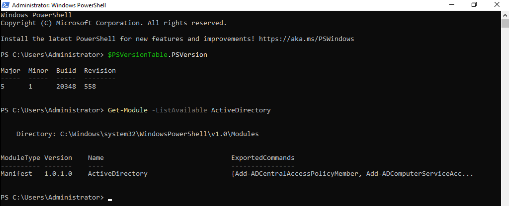
*Screenshot 01, Beginning: PowerShell 5.1 (build 20348, Windows Server 2022) and the ActiveDirectory module installed. Without that module, every script would fail on its first command.*

**Snag 1: a file was in the wrong folder.** I listed the repo before running anything. `new_hires.csv` had landed in `scripts\` and the `data\` folder was empty. The Joiner script expects `..\data\new_hires.csv`, so its first run would have stopped with a file not found error.

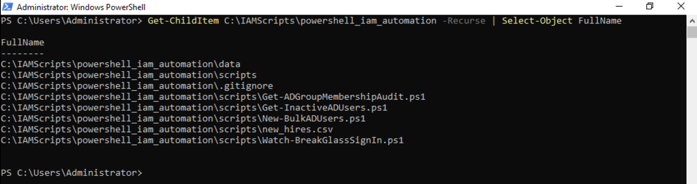
*Screenshot 02, Snag: `scripts\new_hires.csv`, and nothing under `data\`.*

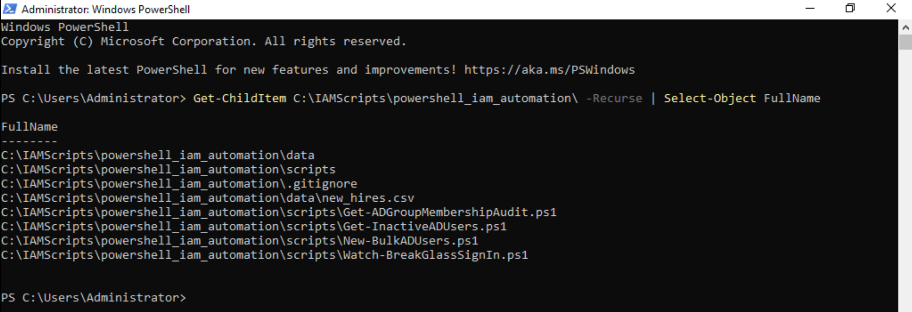
*Screenshot 03, after the fix: `data\new_hires.csv`. Caught by a preflight look, not by a failure.*

Every script documents itself, so anyone can type `Get-Help` and see what it does without reading code.

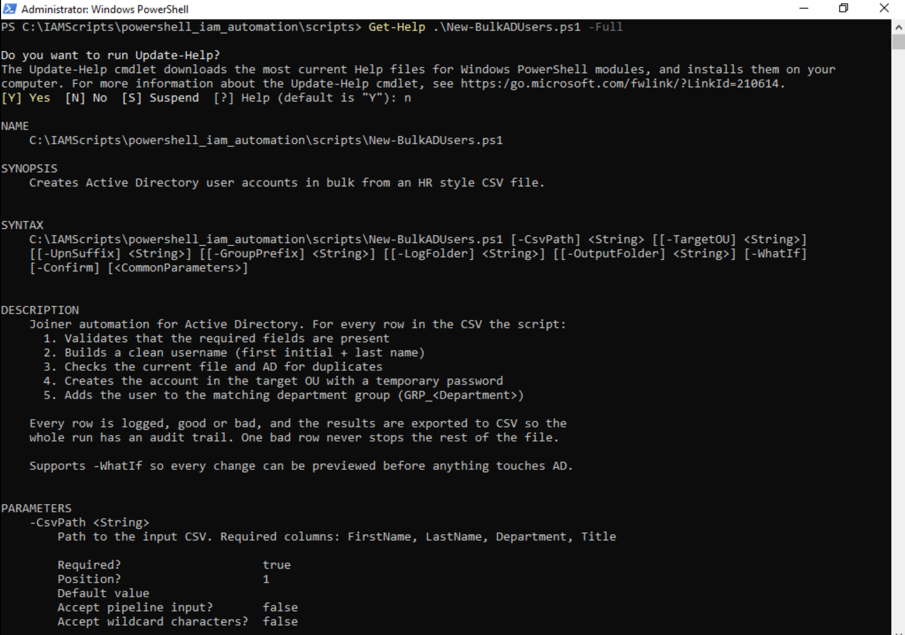
*Screenshot 04, Middle: the built in help for the Joiner script. SYNTAX lists `-WhatIf` and `-Confirm` even though I never typed them as parameters. PowerShell adds them because the script declares `SupportsShouldProcess`.*

**Snag 2: paste into the VM stopped working.** Guest Isolation had copy and paste enabled and it still would not paste. Clipboard sharing has three layers: the VMware setting, VMware Tools running inside the guest, and how the program accepts a paste. I worked through them in order (a Notepad paste test, the VMware Tools service, the guest session) and paste was working again before the build started.

Then I built a separate playground so every Week 8 change stays in one OU. Engineers call this limiting the blast radius.

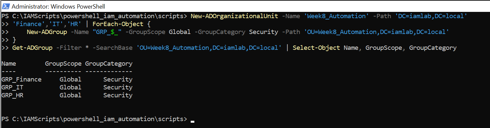
*Screenshot 05, Middle: the Week8_Automation OU and three department groups created with code. There is no GRP_Marketing on purpose.*

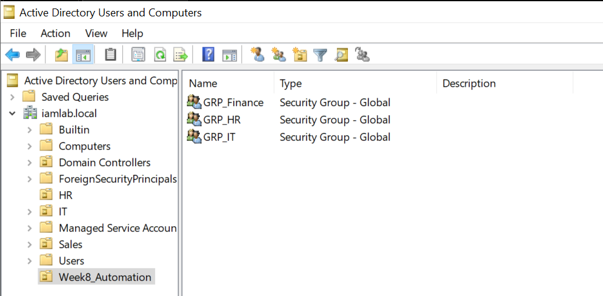
*Screenshot 06, End: the same result in ADUC. Week 1's HR, IT, and Sales OUs sit untouched next to it.*

### Engineer notes

- **Verify the layout before the first run.** A thirty second directory listing caught what would have been the first failure of the week.
- **Isolate the blast radius.** A dedicated OU means any cleanup command can be scoped to one place.

---

## Part 2: Script 1, the Joiner robot

### Situation

A batch of 10 new hires arrives from HR. Before automating anything, I timed the manual way so the "after" number would mean something.

### Build and snags

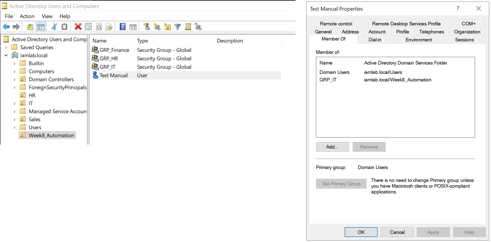
*Screenshot 07, Beginning: one user created by hand in ADUC with a title, department, and GRP_IT membership. **1 minute 20 seconds**, with ADUC already open to the right OU and no interruptions. Ten users would take about 13 minutes 20 seconds.*

The HR file had four problems planted on purpose, like rotten apples in a basket, to prove the script sorts them out instead of breaking:

| Row | Trap | What should happen |
|---|---|---|
| 5 | Liam O'Brien has an apostrophe | Username becomes `lobrien` |
| 7 | Jordan has no last name | Row fails with a clear reason, every other row keeps going |
| 8 | Aisha Carter appears twice | Second copy is skipped, no duplicate account |
| 9 | Devon works in Marketing, and there is no GRP_Marketing | Account is created and flagged for follow up instead of silently missing access |

Row numbers start at 2 because row 1 is the header. That way the log matches what someone sees when they open the file in Excel.

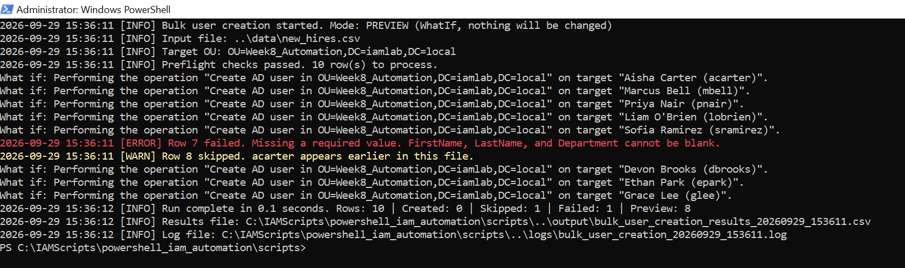
*Screenshot 08, Middle: the dress rehearsal. 8 previews, row 7 failed, row 8 skipped, 0 created, 0.1 seconds. Nothing changed in AD.*

**Snag 3: I missed the console output of the first live run.** I did not lose it. The script had written every line to its log file, which is exactly why the logging exists.

**Snag 4: the run time was measuring me, not the script.** When I reran the script, it reported 11.2 seconds. The dress rehearsal had taken 0.1. The stopwatch started before the password prompt, so it counted the seconds I spent typing. I moved the stopwatch restart to right after the prompt so the reported number only measures the script's work.

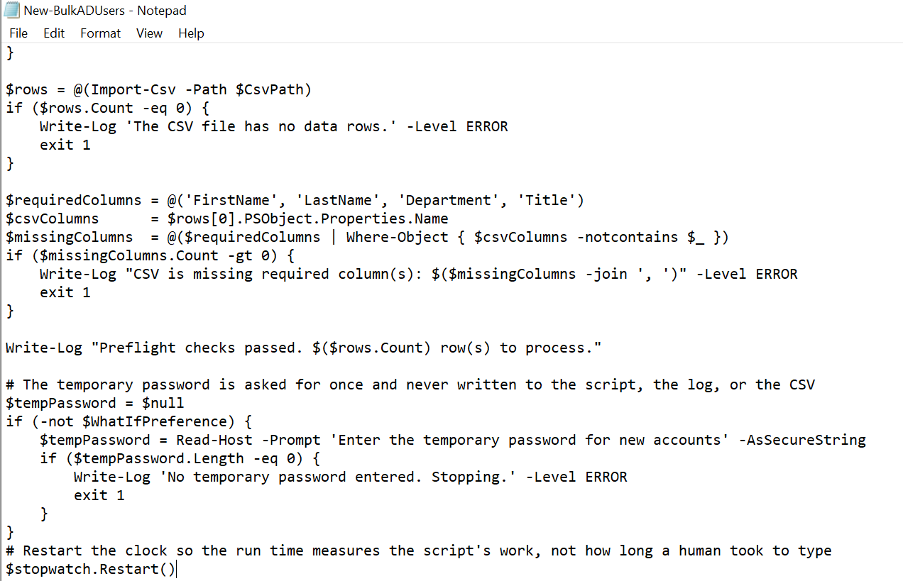
*Screenshot 09, after the fix: `$stopwatch.Restart()` placed after the password prompt.*

**Snag 5: a stray letter nearly broke the script.** While saving that edit, a missed Ctrl+S typed an `s` onto the end of `$stopwatch.Restart()`. PowerShell reads the whole file before running any of it, so that one letter would have stopped every row. I caught it by running another WhatIf before touching AD. That is what the dress rehearsal is for.

Then I reset the OU so the real run would start clean. I rehearsed the delete too, because deleting is the one command you really do not want to get wrong.

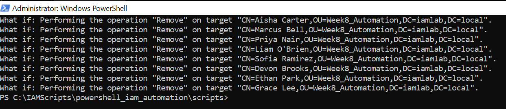
*Screenshot 10, Middle: `Remove-ADUser -WhatIf` scoped to Week8_Automation. Exactly the 8 Week 8 users, nothing from any other OU.*

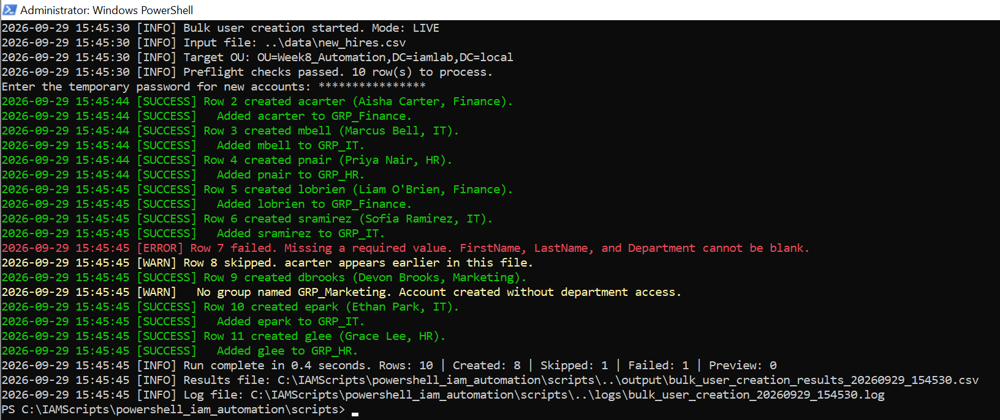
*Screenshot 11, End: the clean live run. 8 created with their department groups, row 7 failed, row 8 skipped, Devon created with a warning, **0.4 seconds**. The prompt at 15:45:30 and the first create at 15:45:44 show the 14 seconds of password typing that Snag 4 would have counted.*

Then I checked the robot's work instead of trusting it.

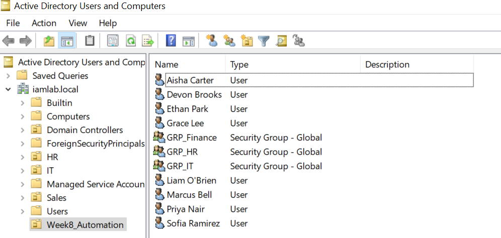
*Screenshot 12, End: 8 users and 3 groups in the OU.*

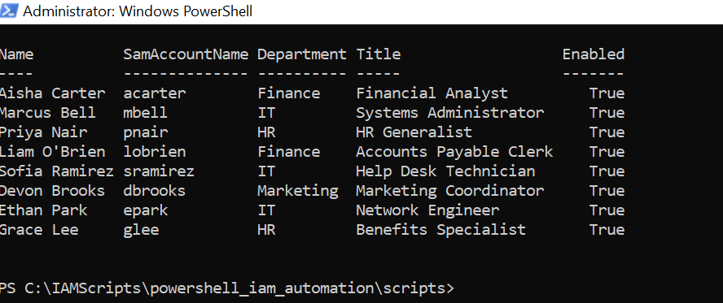
*Screenshot 13, End: names, usernames, departments, titles, all enabled.*

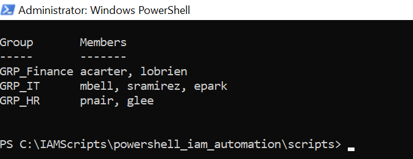
*Screenshot 14, End: Finance has acarter and lobrien, IT has mbell, sramirez, and epark, HR has pnair and glee. Devon is in no group, exactly as the warning said.*

**Snag 6: `Import-Csv` refused a file handed to it through the pipe.** "You must specify either the Path or LiteralPath parameters, but not both." In Windows PowerShell 5.1, a file piped into `Import-Csv` fills in two settings at once, and the cmdlet refuses to guess which one to use. The fix was to grab the file first, then pass it explicitly with `-Path`.

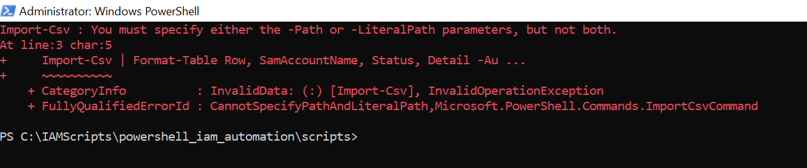
*Screenshot 15, Snag: CannotSpecifyPathAndLiteralPath. The error named the exact problem.*

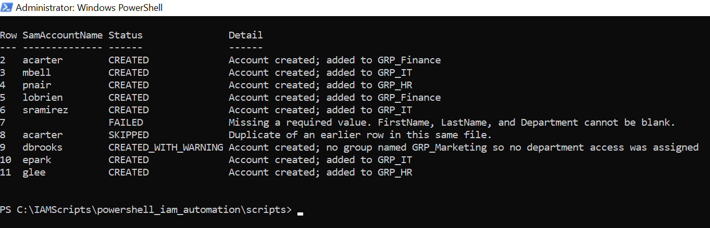
*Screenshot 16, after the fix: every row with a status and a plain English reason. Devon shows CREATED_WITH_WARNING, not CREATED, because a success that still needs follow up should not look like a clean success.*

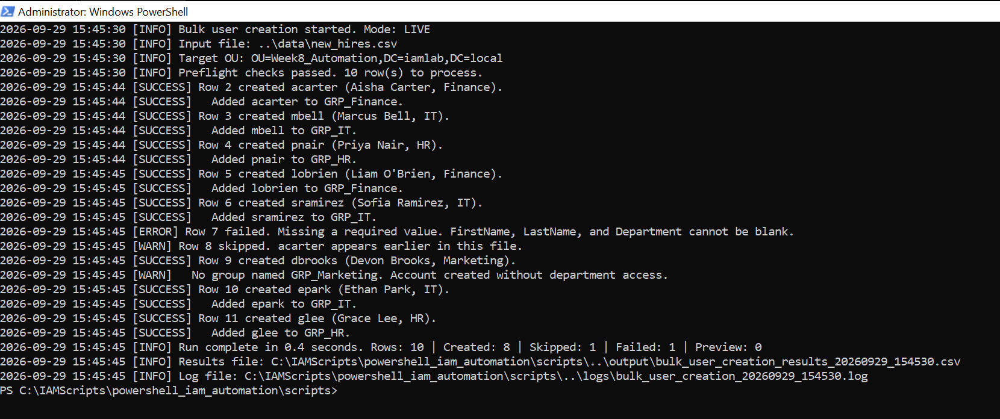
*Screenshot 17, End: the log. No colors, built to be searched and stored. The password prompt is not in it. The password never touched the disk.*

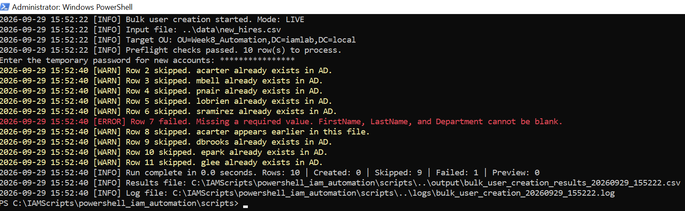
*Screenshot 18, End: the same file run again. Created 0, Skipped 9, Failed 1. Nothing duplicated, nothing overwritten.*

### Engineer notes

- **Skip, do not auto number, on a username collision.** A duplicate can mean a rehire, two different people, or a double request. A human should make that call, so the script skips and says why instead of quietly creating `acarter2`.
- **One bad row never stops the file.** Each row has its own error handling, and group assignment has its own too, so a group problem never marks a created account as failed.
- **The CSV is for people, the log is for troubleshooting.** Two audiences, two files.
- **The password is a SecureString,** asked once, never shown, never logged, never stored in the script.

### Real world mapping

This is the core of a Joiner process: HR data in, accounts and birthright access out, with an audit trail. It is the same job SailPoint did in Week 6, done here with nothing but PowerShell, which is how many companies handle it before or alongside an IGA platform.

---

## Part 3: Script 2, the inactive account report

### Situation

Accounts nobody uses are unlocked doors in an empty building. If someone leaves and their account stays on, an attacker can use it and nobody notices. The report needed to find those accounts without flagging brand new hires who simply have not signed in yet.

### Build

AD's `lastLogonTimestamp` is copied to every domain controller but only refreshed about every 9 to 14 days. When the question is "has this person been gone 90 days," a two week lag does not change the answer, so the script uses it.

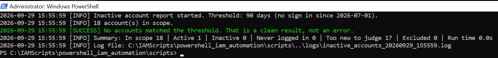
*Screenshot 19, Beginning: 18 accounts in scope, 1 active, 17 too new to judge, 0 findings. In a 33 day old lab, zero is the correct answer, and the script says so in green instead of looking broken. No findings, no empty CSV.*

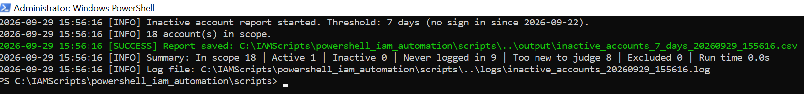
*Screenshot 20, Middle: the same 18 accounts at 7 days. The 9 Week 1 users move to Never logged in, and the 8 Week 8 hires stay protected as too new to judge. The logic works in both directions.*

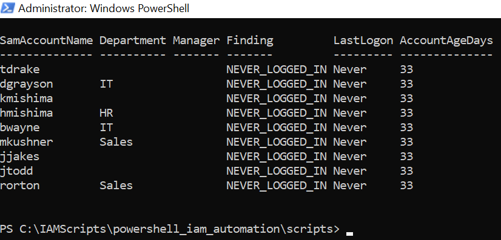
*Screenshot 21, Middle: the report. **An unplanned finding:** tdrake, kmishima, jjakes, and jtodd have no Department. Fed through the Joiner script, they would get no birthright access at all, just like Devon.*

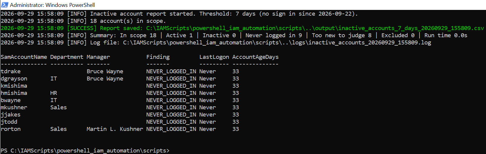
*Screenshot 22, End: managers added for three users, and the report turns long AD addresses into names. Each manager is looked up once no matter how many people report to them. The managers themselves are also on the list, which in a real review means escalating a level instead of waiting on someone who may be gone too.*

### Engineer notes

- **Read only on purpose.** The report produces evidence. Disabling accounts is a separate, approved step, not something a report should do on its own.
- **Automation is only as good as the data.** Four missing departments would quietly break Joiner automation. That is the most common reason IAM automation fails.

### Real world mapping

Dormant account reports are standard evidence in SOX and access reviews. The manager column is what makes a report actionable: it tells the reviewer who to ask.

---

## Part 4: Putting the report on autopilot

### Situation

A report that only runs when someone remembers is not a control. I scheduled it for every Monday at 7:00 AM, running whether anyone is logged in or not.

### Build and snags

**Snag 7: two settings that would have failed silently.** I first saved the task as "Run only when user is logged on," which means it would never run on an unattended server, and it still would have shown Ready. It was also configured for Windows Vista and Server 2008. I changed both.

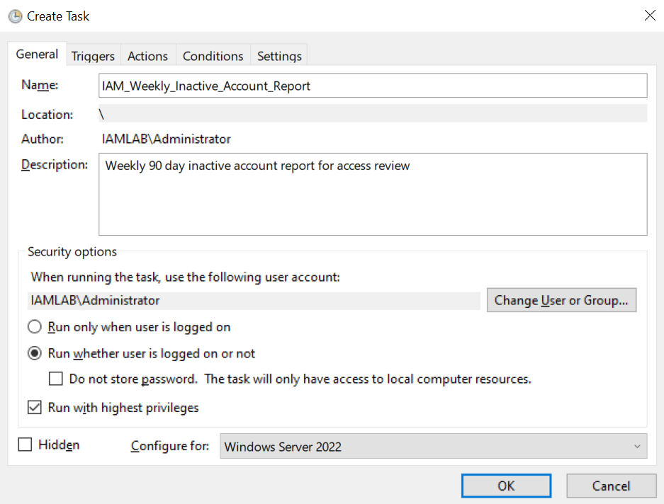
*Screenshot 23, Beginning: runs whether the user is logged on or not, highest privileges, configured for Windows Server 2022.*

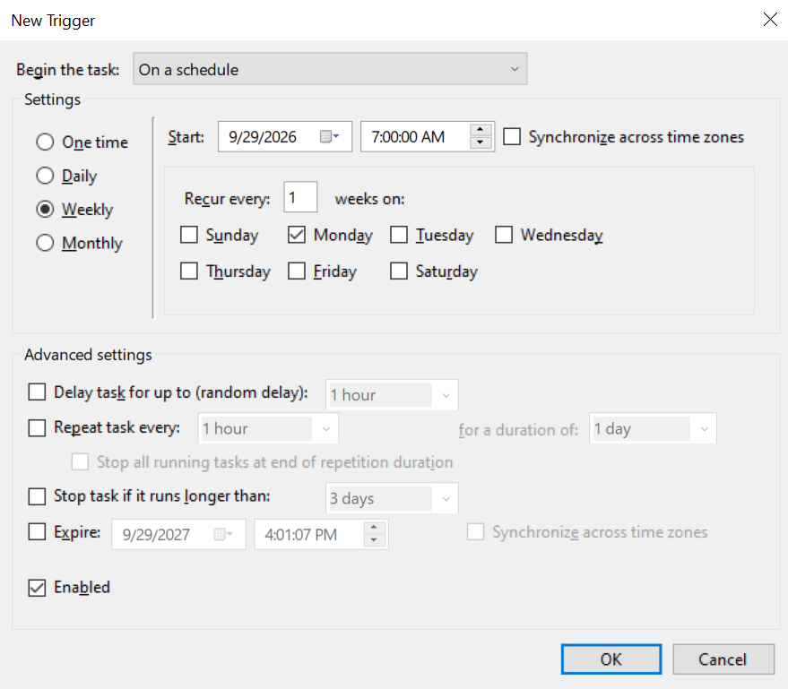
*Screenshot 24, Middle: weekly, Mondays, 7:00 AM.*

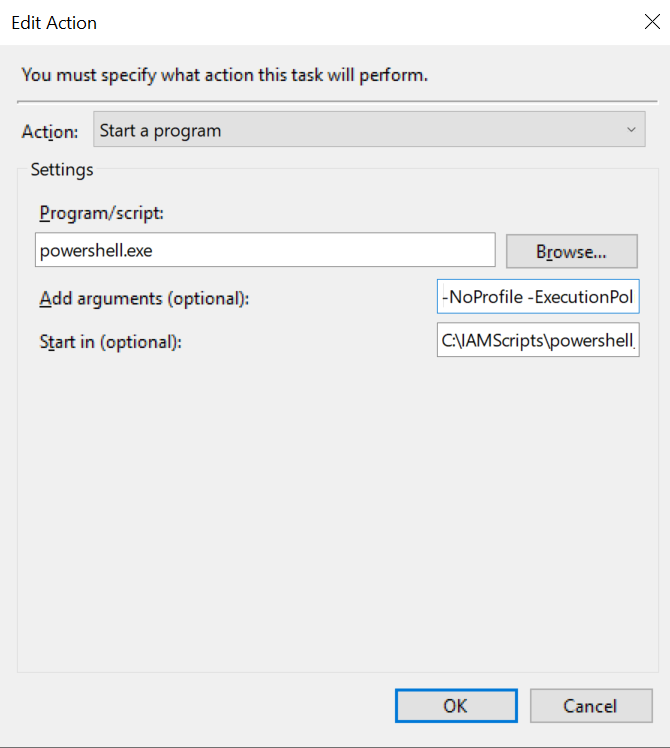
*Screenshot 25, Middle: `powershell.exe` with arguments and a Start in folder. The boxes are too narrow to read, so I verified them with code.*

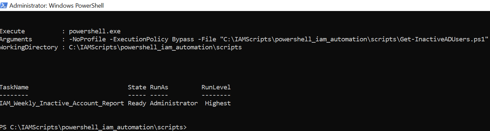
*Screenshot 26, Middle: the full command, working directory, Ready state, and Highest run level, readable and checked for typos.*

**Snag 8: the scheduled run failed with 0x1 and wrote no log.** The script had worked every single time I ran it by hand.

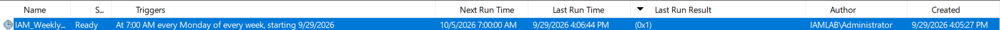
*Screenshot 27, Snag: ran at 4:06:44 PM, Last Run Result 0x1.*

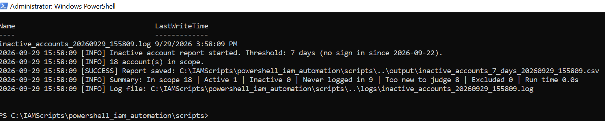
*Screenshot 28, Snag: the newest log is from 3:58 PM, my manual run. The task failed before writing its first line.*

A scheduled task has no window, so its error disappears. Instead of guessing, I ran the task's exact command in Command Prompt.

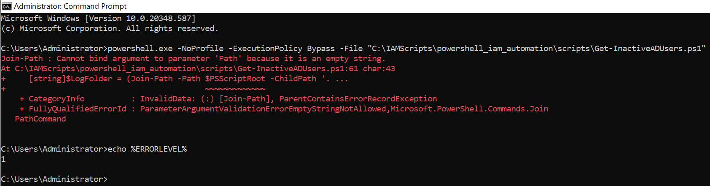
*Screenshot 29, Middle: reproduced. Exit code 1, and the real error: `Join-Path` was handed an empty `$PSScriptRoot` on line 61.*

**Root cause:** in Windows PowerShell 5.1, `$PSScriptRoot` is empty inside a script's param block defaults when the script is launched with `powershell.exe -File`, which is exactly how Task Scheduler starts it. Typing `.\Get-InactiveADUsers.ps1` by hand fills it in, so hand testing never saw the problem.

**Fix:** resolve the script's folder in the body of the script, with a fallback, and apply it to all four scripts.

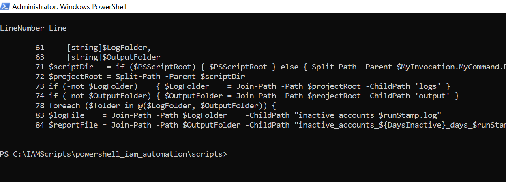
*Screenshot 30, after the fix: the param block (lines 61 and 63) no longer depends on `$PSScriptRoot`. Lines 71 to 74 resolve the folders in the body.*

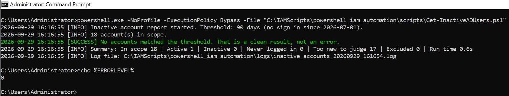
*Screenshot 31, after the fix: the same command that failed now returns 0. Bonus: the log path reads `powershell_iam_automation\logs` instead of `scripts\..\logs`.*

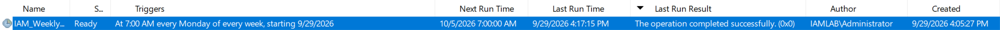
*Screenshot 32, End: ran at 4:17:15 PM, "The operation completed successfully. (0x0)."*

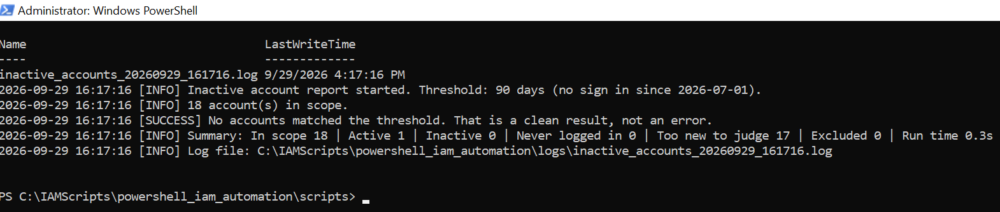
*Screenshot 33, End: a log written at 4:17:16 PM, one second after the trigger, with the task's 90 day threshold. That is the task's own run, not one of mine.*

### Engineer notes

- **Test automation the way it will actually run.** The bug only existed in the unattended launch path.
- **Reproduce before you fix.** Running the exact task command turned a silent 0x1 into a line number.
- **Prove a job that finds nothing.** A correct 90 day run creates no CSV, so the log is the proof it ran.
- **In production this would not run as the domain Administrator.** It would use a Group Managed Service Account with read only rights, since a report needs to read accounts, not change them. Service account credentials are exactly what PAM tools like CyberArk protect.

### Real world mapping

"The script works when I run it but not on a schedule" is a classic operations ticket. The usual suspects are the account the task runs as, the starting folder, and anything the script assumes about how it was launched.

---

## Part 5: Script 3, the group membership audit

### Situation

Being in GRP_IT is like holding the key to the IT room. I wanted a list of every key and who holds it, including people who got a key because their group was put inside another group, with flags on the keys that should not be out there.

### Build and snags

I planted a half finished Leaver: Marcus Bell's account was disabled, but nobody removed his group access. It happens at real companies all the time, because disabling feels like done. I also put GRP_Finance inside a file share group to create nested access.

**Snag 9: three answers mashed into one table.** My first proof screenshot showed Marcus twice and a group with no type. When several commands send results to the screen in a row, PowerShell draws one table using the first result's columns. I gave each result its own labeled table.

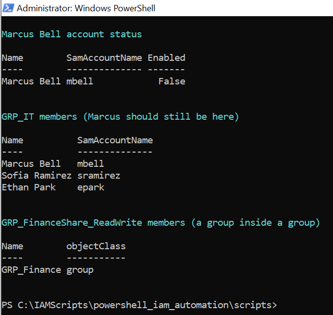
*Screenshot 34, Beginning: Marcus is disabled, still in GRP_IT, and GRP_FinanceShare_ReadWrite contains a group, not people.*

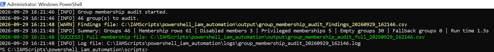
*Screenshot 35, Middle: 46 groups in 1.3 seconds, 61 membership rows, 3 disabled members, 5 privileged memberships, 30 empty built in groups, 0 fallbacks.*

**Snag 10: I planted one problem and the audit found three.** That is not a bug. A real audit never hands you a perfectly clean list. The engineer's job is to triage.

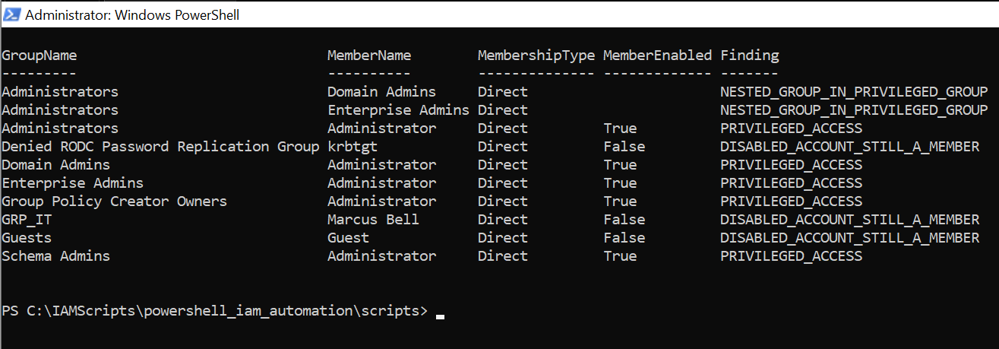
*Screenshot 36, Middle: the findings with empty groups filtered out.*

| Finding | Account | Verdict | Reason |
|---|---|---|---|
| DISABLED_ACCOUNT_STILL_A_MEMBER | Marcus Bell in GRP_IT | **Remediate** | Leaver kept department access |
| DISABLED_ACCOUNT_STILL_A_MEMBER | krbtgt in Denied RODC Password Replication Group | Accept, by design | The Kerberos signing account is meant to be disabled, and this group protects it |
| DISABLED_ACCOUNT_STILL_A_MEMBER | Guest in Guests | Accept, by design | Windows default |
| PRIVILEGED_ACCESS (5 rows) | Administrator | Accept for a lab only | In production, admins use a separate named admin account with just in time elevation, like the PIM setup in Week 7 |
| NESTED_GROUP_IN_PRIVILEGED_GROUP | Domain Admins and Enterprise Admins in Administrators | Accept, document | Default AD structure, but every path into a privileged group belongs on record |

The full table is in [`evidence/02_group_audit_triage.md`](evidence/02_group_audit_triage.md).

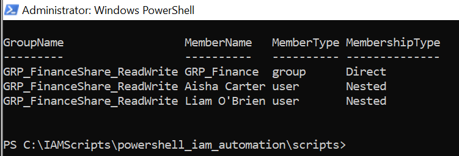
*Screenshot 37, Middle: GRP_Finance is the only direct member of the file share group, but Aisha and Liam reach it through nesting. Looking only at direct members, you would see one group and zero people.*

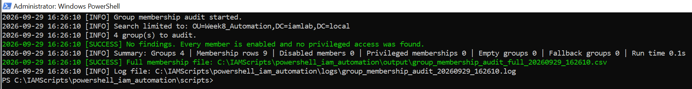
*Screenshot 38, after the fix: Marcus removed from GRP_IT. A scoped rerun shows no findings and 0 disabled members.*

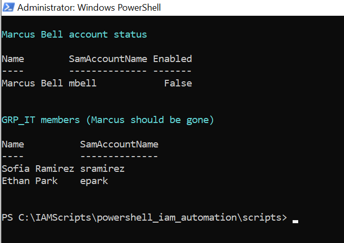
*Screenshot 39, End: still disabled, no longer holding the key. Compare with Screenshot 34.*

### Engineer notes

- **Disabling is not deprovisioning.** A finished Leaver removes access, not just the ability to sign in.
- **A built in fallback.** `Get-ADGroupMember` is known to fail on some built in groups. The script catches that and reads the raw member list instead of crashing. My domain did not trigger it, and it is still there for the next one.

### Real world mapping

This is the evidence behind access certifications in Week 11: who holds what, how they got it, and which findings were fixed versus accepted with a reason.

---

## Part 6: Script 4, the break glass alarm (closing Week 7 CA005)

### Situation

In Week 7 I excluded the break glass account from every Conditional Access policy so nobody could ever get locked out. That makes it the most powerful and least watched account in the tenant. I deferred its alert to this week to keep the lab at $0, and I made two promises for it: query by userPrincipalName, not display name, and alert somewhere other than email, since the tenant has no mailbox.

### Build

I signed in as the break glass account in a private window first, because sign in logs take several minutes to show up in Entra.

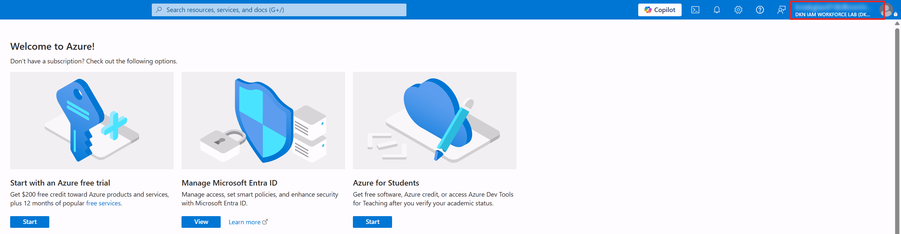
*Screenshot 40, Beginning: the break glass account signed in to the Azure portal. The account name is redacted, the same way it would be in production documentation.*

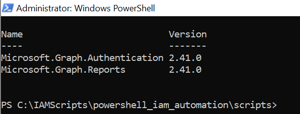
*Screenshot 41, Middle: only the two Graph modules the script needs, instead of the entire Microsoft Graph module. Least privilege applies to what you install too.*

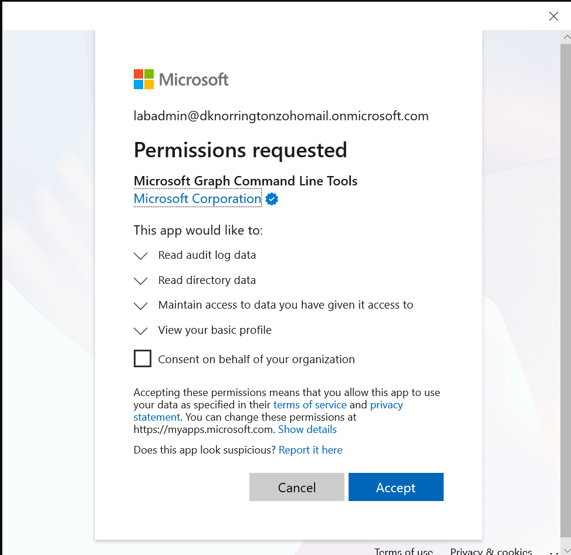
*Screenshot 42, Middle: every permission says Read. I left "Consent on behalf of your organization" unchecked, so the grant applies to my admin account only, not every user in the tenant.*

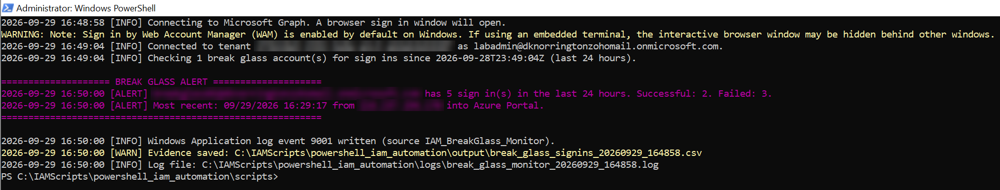
*Screenshot 43, End: the alarm. 5 sign ins in 24 hours, 2 successful and 3 failed, Event 9001 written, evidence saved. The Graph query took about 56 seconds, which is normal for sign in logs. Tenant ID, UPN, and IP redacted.*

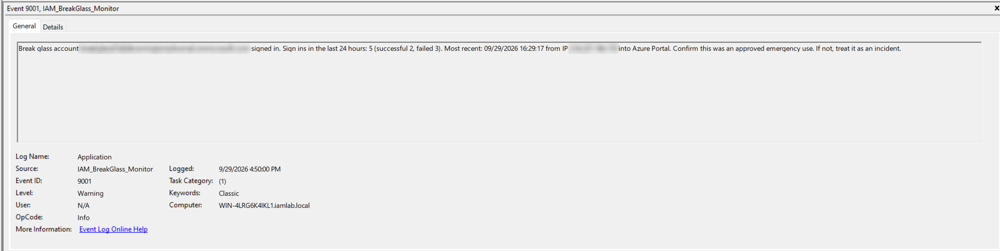
*Screenshot 44, End: the second alarm bell. Event ID 9001, Level Warning, with the instruction to confirm approved emergency use or treat it as an incident. A monitoring tool watching this log would page someone.*

**Snag 11: "Failed: 3" sounded like an attack. It was not.**

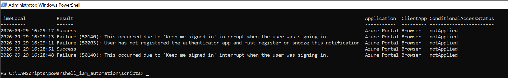
*Screenshot 45, End: the evidence, shown without the IP and location columns so it is safe to publish.*

| Code | What it really was |
|---|---|
| 50140 (twice) | The "Stay signed in?" question. Entra logs the pause as an interrupted step, then logs the Success a few seconds later |
| 50203 | Entra nudged the break glass account to register Microsoft Authenticator, and the account moved past the nudge |
| notApplied on all 5 rows | The Week 7 exclusion working as designed, which is exactly why this alarm needs to exist |

**Five log entries were really two sign ins, zero attacks, and one follow up** on how the break glass account is protected. The full breakdown is in [`evidence/03_break_glass_signin_evidence_redacted.md`](evidence/03_break_glass_signin_evidence_redacted.md).

### Engineer notes

- **UPN, not display name.** In Week 7, a filter on the username found nothing because that view matched display names. Any admin can rename an account, so an alert keyed on the display name can be dodged. This script queries `userPrincipalName`.
- **9001 versus 9002.** 9001 means the account was actually used. 9002 means only failed attempts, meaning someone is trying. Different severities, different responses.
- **Known limitation on purpose:** the script signs in to Graph as me. Running it unattended on a schedule needs an app registration with a certificate, which is the Week 9 upgrade.

### Real world mapping

Microsoft's emergency access guidance says to monitor every break glass sign in and alert on it. Most companies do this with Log Analytics or a SIEM. This build does the same detection with PowerShell, Graph, and the Windows Event Log at no cost.

---

## Final result

| Deliverable | Status | Evidence |
|---|---|---|
| Workbench | PowerShell 5.1, AD module, isolated OU with 3 department groups | Screenshots 01 to 06 |
| Script 1: Joiner automation | 10 row batch in 0.4 seconds versus about 13 minutes 20 seconds by hand. 8 created, 1 bad row rejected, 1 duplicate skipped, 1 missing group flagged. Safe to rerun | Screenshots 07 to 18 |
| Script 2: Inactive accounts | 90 day report with new hire protection and manager lookup. Found a 4 account data quality gap | Screenshots 19 to 22 |
| Scheduled weekly report | Runs unattended Mondays at 7:00 AM, 0x0, log proves execution | Screenshots 23 to 33 |
| Script 3: Group audit | 46 groups in 1.3 seconds, 1 real finding remediated, 4 finding types triaged, nested access revealed | Screenshots 34 to 39 |
| Script 4: Break glass alert | Detected a real break glass sign in, wrote Event 9001, saved evidence. Closes Week 7 CA005 | Screenshots 40 to 45 |

---

## Troubleshooting summary

| # | Snag | Layer | Root cause | Fix |
|---|---|---|---|---|
| 1 | CSV in the wrong folder | File layout | Copy mistake | Caught by listing the repo before the first run |
| 2 | Paste into the VM failed | Virtualization | Clipboard sharing broken inside the guest despite Guest Isolation | Worked through VMware Tools and the guest session |
| 3 | Missed first live run output | Human | Console scrolled and the run was over | Recovered from the log file |
| 4 | Run time of 11.2 seconds | Metric design | Stopwatch counted the password prompt | Restarted the clock after the prompt |
| 5 | Stray `s` after an edit | Syntax | Missed Ctrl+S typed a letter | Caught by a WhatIf run before touching AD |
| 6 | Import-Csv Path and LiteralPath error | PowerShell 5.1 | Piped file bound to two parameters | Passed `-Path` explicitly |
| 7 | Task set to run only when logged on, configured for Vista | Scheduler config | Default settings | Run whether logged on or not, configured for Server 2022 |
| 8 | Scheduled task 0x1, no log | PowerShell 5.1 launch path | `$PSScriptRoot` empty in param defaults under `-File` | Resolved the folder in the script body, all 4 scripts |
| 9 | Proof tables mashed together | Output formatting | PowerShell formats consecutive results as one table | Labeled `Format-Table` per result |
| 10 | 3 disabled members found, 1 planted | Audit triage | 2 built in accounts are disabled by design | Triaged: 1 remediated, 2 accepted with reasons |
| 11 | "Failed: 3" on break glass | Log interpretation | Sign in interrupts are logged as failures | Triaged from error codes, logged a script improvement |

---

## Verification log

| Area | What could have hidden a problem | How I checked | What the evidence showed |
|---|---|---|---|
| Repo layout | A misplaced file breaks the first run | Listed every file before running | CSV in the wrong folder, fixed |
| Joiner accuracy | A script can report success and still be wrong | ADUC, `Get-ADUser`, and group membership after the run | All 8 accounts and 7 group memberships correct |
| Idempotence | A rerun could create duplicates | Ran the same file twice | 0 created, 9 skipped |
| Metrics | A timer can measure the wrong thing | Compared WhatIf time to live time | Found and fixed the password prompt in the timer |
| Scheduled task | A GUI box too narrow to read | `Get-ScheduledTask` in PowerShell | Full command, Ready, Highest |
| Unattended run | A task can show Ready and still fail | Last Run Result plus the newest log | Found 0x1, fixed, proved 0x0 with a matching log |
| Audit results | Findings can be expected, not risky | Triage of every finding type | 1 real, rest by design with reasons |
| Remediation | A fix can miss a path | Scoped rerun after the change | 0 findings |
| Alert | A detection that finds nothing looks fine | Triggered it with a real break glass sign in | Alert fired, Event 9001 written |

---

## What I would change before calling this production ready

- **Run Graph unattended** with an app registration and certificate (Week 9), then schedule the break glass monitor every 15 minutes.
- **Label sign in interrupts** like 50140 as steps, not failures, so the alert counts only real failures.
- **Protect the break glass account with phishing resistant MFA**, a FIDO2 key or passkey locked in a safe, plus an authentication strength policy for the break glass group.
- **Run scheduled tasks as a Group Managed Service Account** with read only AD rights, never the domain Administrator.
- **Send alerts to a real channel**, such as a SIEM forwarding the Event Log or a Teams webhook.
- **Add an exceptions list to the group audit** so known by design findings like krbtgt are recorded once and stop reappearing.
- **Validate HR data before the Joiner runs**, rejecting rows with a missing Department instead of creating accounts with no birthright access.
- **Sign the scripts** with a code signing certificate so the servers can run AllSigned instead of RemoteSigned.
- **Keep scripts in version control with a review step**, so no change reaches a production scheduler without a second set of eyes.

---

## Interview talking points (Problem, Solution, Impact, Learning)

**"Tell me about something you automated."**

- **Problem:** Creating accounts by hand took 80 seconds each, and a 10 person batch would take about 13 minutes with plenty of room for typos.
- **Solution:** A PowerShell Joiner script that validates every row, builds usernames, checks for duplicates in the file and in AD, creates the account, and assigns department access, with a WhatIf preview and a log for every run.
- **Impact:** The same batch ran in 0.4 seconds, rejected a bad row, skipped a duplicate, flagged a missing group, and could be rerun safely.
- **Learning:** Measure honestly. My first timing counted my own typing. I fixed the metric before I reported it.

**"Tell me about a time something worked in testing and failed in production."**

- **Problem:** My weekly report returned 0x1 from Task Scheduler with no log, even though it worked every time I ran it.
- **Solution:** I ran the task's exact command by hand, which reproduced exit code 1 and exposed the real error: `$PSScriptRoot` is empty in param defaults when a script starts with `-File` in PowerShell 5.1.
- **Impact:** I moved the folder logic into the script body, fixed all four scripts, and proved it with 0x0 and a log written one second after the trigger.
- **Learning:** Test automation the way it will actually run, not the way that is convenient.

**"Your audit shows a disabled account in a group. What do you do?"** Triage first. In my audit, 1 of 3 was a real Leaver who kept access, and 2 were built in accounts disabled by design. I fixed the real one, documented why the others are accepted, and proved it with a clean rerun.

**"What is the difference between lastLogon and lastLogonTimestamp?"** `lastLogon` is exact but lives separately on each domain controller. `lastLogonTimestamp` is copied everywhere but only refreshed about every 9 to 14 days. For a 90 day inactive report, the replicated one is the right choice.

**"How do you monitor a break glass account?"** Alert on every sign in, successful or not, keyed on the UPN rather than the display name, and treat any use that was not approved as an incident. Mine reads the Entra sign in logs through Graph with read only scopes and writes Event 9001 or 9002 to the Windows Event Log.

---

## Resume bullet

> Developed 4 PowerShell IAM automation scripts covering bulk Active Directory provisioning from CSV, a scheduled 90 day inactive account report with manager lookup, a group membership audit with nested access and risk flags, and a Microsoft Graph break glass sign in alert, each with preflight checks, logging, CSV evidence, and exit codes.
>
> Reduced a 10 user onboarding batch from about 13 minutes of manual ADUC work to 0.4 seconds, caught a disabled Leaver still holding group access, and resolved 11 issues including a PowerShell 5.1 `$PSScriptRoot` bug that only appeared when Task Scheduler launched the script.

---

## Run it yourself

Requirements: Windows PowerShell 5.1, the ActiveDirectory module, and rights in a test OU. Script 4 also needs `Microsoft.Graph.Authentication`, `Microsoft.Graph.Reports`, and Entra ID P1 or P2.

```powershell
# Preview first, always
.\scripts\New-BulkADUsers.ps1 -CsvPath .\data\new_hires.csv -TargetOU 'OU=YourTestOU,DC=contoso,DC=local' -UpnSuffix 'contoso.local' -WhatIf

# Weekly style report
.\scripts\Get-InactiveADUsers.ps1 -DaysInactive 90

# Audit one OU
.\scripts\Get-ADGroupMembershipAudit.ps1 -SearchBase 'OU=YourTestOU,DC=contoso,DC=local'

# Break glass monitor
.\scripts\Watch-BreakGlassSignIn.ps1 -BreakGlassUpn 'your_breakglass@contoso.onmicrosoft.com'
```

Every script supports `Get-Help .\scripts\<name>.ps1 -Full`. Logs and output land in `logs\` and `output\`, which are git ignored because they contain account data.

---

## Repository layout

```
powershell_iam_automation/
├── README.md
├── .gitignore
├── data/
│   └── new_hires.csv
├── evidence/
│   ├── 01_script_run_results.md
│   ├── 02_group_audit_triage.md
│   └── 03_break_glass_signin_evidence_redacted.md
├── scripts/
│   ├── New-BulkADUsers.ps1
│   ├── Get-InactiveADUsers.ps1
│   ├── Get-ADGroupMembershipAudit.ps1
│   └── Watch-BreakGlassSignIn.ps1
└── screenshots/
    ├── 01_powershell_version_and_ad_module_check.png
    ├── 02_error_csv_in_wrong_folder.png
    ├── 03_fix_csv_moved_to_data_folder.png
    ├── 04_get_help_shows_script_documentation.png
    ├── 05_week8_ou_and_department_groups_created.png
    ├── 06_week8_ou_in_aduc.png
    ├── 07_manual_user_creation_baseline_in_aduc.png
    ├── 08_bulk_create_whatif_preview.png
    ├── 09_fix_stopwatch_excluded_password_prompt.png
    ├── 10_reset_whatif_scoped_to_week8_ou.png
    ├── 11_bulk_create_live_run_results.png
    ├── 12_new_users_in_week8_ou_aduc.png
    ├── 13_get_aduser_verification.png
    ├── 14_department_group_membership_verified.png
    ├── 15_error_import_csv_path_and_literalpath.png
    ├── 16_results_csv_row_by_row_outcomes.png
    ├── 17_log_file_audit_trail.png
    ├── 18_rerun_safe_all_rows_skipped.png
    ├── 19_inactive_report_90_day_run.png
    ├── 20_inactive_report_7_day_threshold_proof.png
    ├── 21_inactive_report_csv_output.png
    ├── 22_inactive_report_with_manager_lookup.png
    ├── 23_scheduled_task_general_tab.png
    ├── 24_scheduled_task_trigger_weekly.png
    ├── 25_scheduled_task_action_arguments.png
    ├── 26_scheduled_task_verified_in_powershell.png
    ├── 27_error_scheduled_task_last_run_result_0x1.png
    ├── 28_error_no_log_from_scheduled_run.png
    ├── 29_troubleshoot_manual_run_reproduces_0x1.png
    ├── 30_fix_resolve_script_folder_in_body_not_param_block.png
    ├── 31_fix_manual_run_exit_code_0.png
    ├── 32_scheduled_task_last_run_result_success.png
    ├── 33_scheduled_run_log_proves_execution.png
    ├── 34_leaver_simulation_disabled_user_still_in_group.png
    ├── 35_group_audit_run_summary.png
    ├── 36_group_audit_findings.png
    ├── 37_group_audit_nested_access_revealed.png
    ├── 38_finding_remediated_rerun_clean.png
    ├── 39_leaver_completed_access_removed.png
    ├── 40_break_glass_test_sign_in_private_window.png
    ├── 41_graph_modules_installed.png
    ├── 42_graph_consent_read_only_scopes.png
    ├── 43_break_glass_alert_fired.png
    ├── 44_break_glass_event_viewer_entry.png
    └── 45_break_glass_signin_evidence.png
```

*Built as part of the IAM Engineer Mentorship Program, Week 8. This is a lab environment with test data only. The break glass UPN, tenant ID, and source IP addresses are redacted.*
